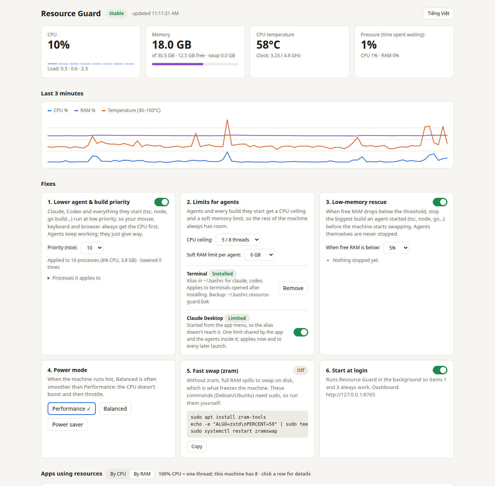

# Resource Guard

**Không để agent AI và các build do chúng chạy làm đứng máy.**

[English](README.md)

<picture>
  <source media="(prefers-color-scheme: dark)" srcset="assets/dashboard-dark.png">
  
</picture>

Giao diện có cả tiếng Việt: bấm nút ở góc trên, hoặc mở `http://127.0.0.1:8765/?lang=vi`.

Các agent viết code như Claude Code hay Codex tự chạy type-check, test và build. Mỗi tác vụ
đó muốn dùng hết các nhân CPU và vài GB RAM. Chạy hai, ba agent cùng trình duyệt là máy
đứng: chuột giật, gõ phím trễ, và khi hết RAM thì hệ thống đẩy xuống swap trên ổ đĩa rồi treo.

Resource Guard là một trang quản lý nhỏ chạy ngay trên máy bạn để xử lý chuyện này. Agent
vẫn làm việc, chỉ nhường đường cho bạn.

- Không cần cài thêm thư viện: chỉ dùng Python 3.10+.
- Chỉ chạy trên máy bạn, tại `http://127.0.0.1:8765`.
- Giao diện tiếng Anh và tiếng Việt.

## Tính năng

| | Linux | macOS |
|---|---|---|
| Theo dõi CPU, RAM, nhiệt độ, áp lực và mức dùng của từng app | ✅ | ✅ (không có nhiệt độ vì cần root) |
| **Hạ ưu tiên agent**: agent, mọi thứ nó chạy và các công cụ build phổ biến chạy ở `nice` thấp | ✅ | ✅ |
| **Trần CPU** cho agent mở từ terminal | ✅ giới hạn cứng (`CPUQuota` của systemd) | ✅ hạ mức QoS (`taskpolicy`: utility, hoặc background = nhân tiết kiệm) |
| **Trần RAM mềm** cho mỗi agent: vượt trần thì agent bị chậm lại và thu hồi RAM, không bị kill | ✅ (`MemoryHigh`) | ❌ macOS không có |
| Giới hạn cho **Claude Desktop** và các agent bên trong | ✅ | ❌ |
| **Cứu khi thiếu RAM**: RAM trống dưới ngưỡng thì dừng *build* lớn nhất do agent chạy. Agent không bao giờ bị dừng | ✅ | ✅ |
| Đổi chế độ nguồn | ✅ (`powerprofilesctl`) | hiển thị Low Power Mode (đổi cần sudo) |
| Trạng thái zram và lệnh cài | ✅ | không cần (macOS tự nén RAM) |
| Tự chạy khi đăng nhập | ✅ systemd user service | ✅ LaunchAgent |
| Dừng hoặc hạ ưu tiên tiến trình của bạn; thành phần desktop được bảo vệ | ✅ | ✅ |

## Cài đặt

```sh
pipx install git+https://github.com/nqh98/resource-guard
resource-guard --open
```

Hoặc chạy thẳng không cần cài:

```sh
git clone https://github.com/nqh98/resource-guard
cd resource-guard
python3 -m resource_guard --open
```

Sau đó bật **Tự chạy khi đăng nhập** trên trang để tool luôn hoạt động.

## Thay đổi trên máy bạn

Mọi thay đổi đều gỡ được ngay trên trang:

| Thay đổi | File | Cách gỡ |
|---|---|---|
| Alias | một khối có đánh dấu trong `~/.bashrc` / `~/.zshrc` | nút *Gỡ bỏ* |
| Giới hạn Claude Desktop (Linux) | `~/.config/systemd/user/app-com.anthropic.Claude-.scope.d/resource-guard.conf` | tắt công tắc |
| Tự chạy khi đăng nhập | `~/.config/systemd/user/resource-guard.service` hoặc `~/Library/LaunchAgents/io.github.resource-guard.plist` | tắt công tắc |
| Cấu hình | `~/.config/resource-guard/config.json` | xóa file |

Tool không bao giờ cần quyền root. Tiến trình chạy dưới quyền root (ví dụ container Docker)
không chỉnh được; hãy giới hạn bằng `docker run --cpus=4 --memory=8g`.

Claude là thương hiệu của Anthropic. Dự án này không liên kết với Anthropic hay OpenAI.

## Giấy phép

MIT
